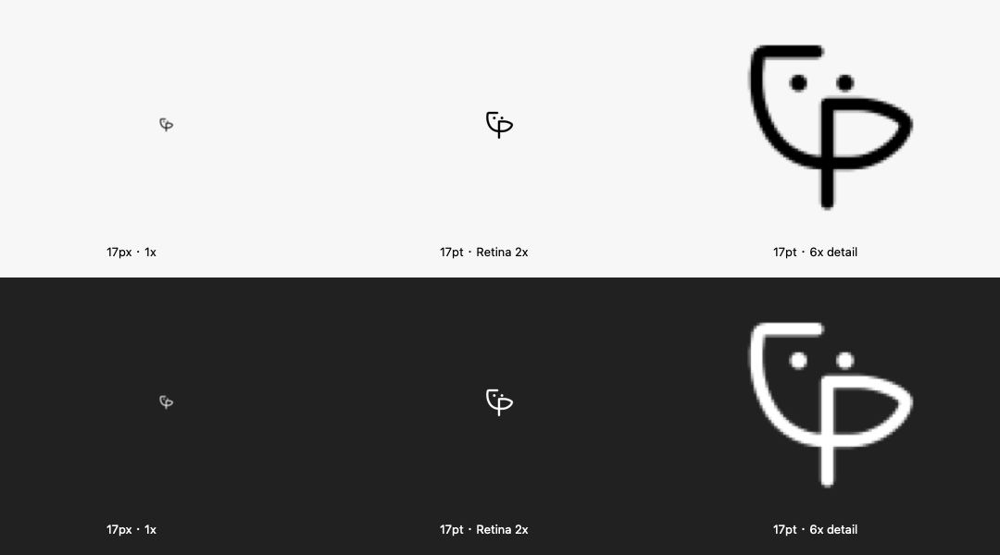

# 菜单栏 ciip 连字

新增 `ligature` 图标选项，沿用户草图把 C 的下沿接入 p 的弧线，中间共用一条下延竖干，保留上方两枚独立圆点。没有外围截图框，不使用系统粗体文字。

这是新增选项，现有 `capture`、`pin` 和 `wordmark` 保留。默认仍为截图框，读取旧偏好不主动更换；未知图标值继续按原校验返回错误并回退默认值，不静默改写用户配置。

原生绘图位于 `internal/app/permissions_darwin.m` 的 `ciipDrawTrayLigature()`；设置页 `frontend/src/settings.ts` 使用同一套 32 单位几何的内联 SVG。路径、线宽、双点坐标由 `frontend/tests/tray-icon.test.js` 对照检查，更新时须同步两处。

导出为黑色加透明通道的 64×64 PNG。MyGo 0.7.4 将菜单栏图片逻辑高度设为 18pt，`IconIsTemplate:true` 交由系统适配浅色、深色和选中状态。2.2 单位线宽对应约 1.24pt；额外检查 17pt Retina 显示与 1x 退化效果。



运行既有脚本可从实际 AppKit 绘图生成预览：

```sh
clang -framework Cocoa -framework CoreGraphics internal/app/permissions_darwin.m scripts/render-tray-icons.m -o build/render-tray-icons
build/render-tray-icons
```

这是原生静态绘图证据，不包含真实菜单栏安装或修改用户偏好的验收。
